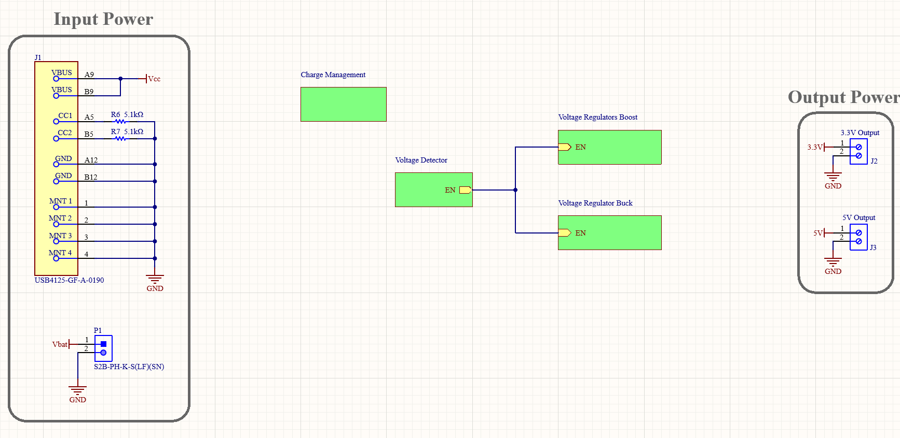

# Li-Ion / Li-Po Charger PCB

A **2.5 × 3.5 cm** board that charges a single-cell Li-Ion / Li-Po battery from USB-C and provides regulated **5 V and 3.3 V** rails – designed in **Altium Designer**, from component selection to schematic, layout, assembly and measurements.

<p align="center">
  
  
</p>

> hepia (HES-SO Geneva) · Hardware Systems Design · 2024 · Solo project
> 📄 [Report (French, 31 pages)](docs/report-fr.pdf)

## Specifications

| Requirement | Target |
|---|---|
| Board size | ≤ 2.5 × 3.5 cm |
| Battery charge current | 500 mA |
| 5 V and 3.3 V outputs | ≥ 500 mA each |
| Components | SMD only, pitch ≥ 0.4 mm |

## Design

<p align="center"></p>

USB-C power feeds four sub-circuits, each with its own schematic sheet:

| Block | Part | Role |
|---|---|---|
| Charge management | Microchip **MCP73831** | linear Li-Ion / Li-Po charger, 4.2 V, charge current set to 500 mA by a 2 kΩ resistor, status LED |
| Voltage detector | ROHM **BD53E30G** | enables the regulators only when the battery is above its minimum voltage |
| Boost regulator | Renesas **ISL97519A** | battery → **5 V** |
| Buck regulator | TI **LM22671-ADJ** | battery → **3.3 V** |

The 2-layer board was routed in Altium, manufactured, then assembled and tested by hand.

## Results

Measured on the bench, with instruments simulating the battery and drawing current from the outputs (35 battery-voltage / load-current combinations, 3.0–4.2 V and 100–500 mA):

- **Outputs**: 5.03 V and 3.25 V on average (within 2 %), about 0.15 V peak-to-peak, holding up to 500 mA.
- **Charging**: about 95 % of the input current goes to the battery; charging stops at 4.2 V.
- **Lessons learned**: the wrong variant of the charger was ordered (`MCP73831-2DCI` instead of `-2ACI`), so the battery is not protected against deep discharge below 2.8 V; the boost converter passes its input through when disabled, so the 5 V rail does not drop to 0 V like the 3.3 V rail. Both are analysed in the report, with improvements for a next revision.

## Repository structure

```
├── hardware/          Altium project: schematics (*.SchDoc), PCB (*.PcbDoc), libraries, BOM,
│   │                  PDF exports of the schematics and layout
│   └── Project Outputs…/   Gerber and drill files sent to the manufacturer
├── report/            report sources (Typst), figures and the Python scripts that plot the measurements
└── docs/              compiled report and images
```

Open `hardware/spycheradrian_csh_charger.PrjPcb` in Altium Designer, or browse the PDF exports (`hardware/*.pdf`) without it.

## Tech

Altium Designer · PCB design · power electronics (linear charger, buck and boost converters) · SMD assembly · lab measurements · Python / Matplotlib · Typst

## License

[MIT](LICENSE)
